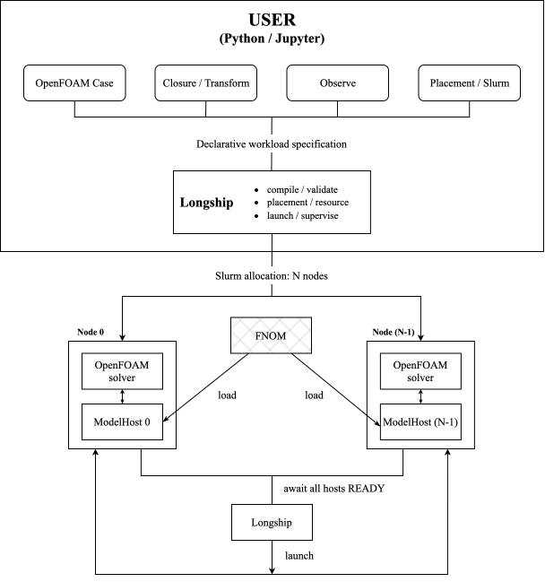
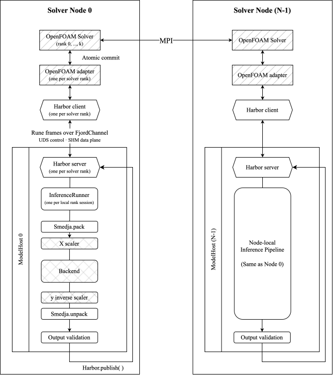

<p align="center">
  
</p>

# FoamNordic

**FOAM Native Orchestration Runtime for Distributed Inference Coupling**

FoamNordic couples OpenFOAM fields to mathematical and machine-learning operators without making Python part of the solver loop. The same `Longship` interface runs an unchanged OpenFOAM case, a field transform, or an equation-level closure supplied by any compatible solver adapter.

FNOM is the self-contained model artefact used by **FoamNordic** and implemented by **BindNordic**. It stores the executable payload together with tensor contracts, scaling, runtime requirements, and compatibility metadata. Fjord moves fields over shared memory, Unix sockets, UCX, or TCP; Longship owns placement, launch, logs, observations, and results.

Python 3.11 and 3.12 are supported. See the [changelog](CHANGELOG.md) for release notes and upgrade guidance.

## Architecture

The diagrams separate workload setup and launch from the field exchange and inference path used during solver execution.

<table>
  <tr>
    <td align="center" valign="bottom"></td>
    <td align="center" valign="bottom"></td>
  </tr>
  <tr>
    <td align="center"><sub>Figure 1: Setup and launch.</sub></td>
    <td align="center"><sub>Figure 2: Runtime exchange and inference.</sub></td>
  </tr>
</table>

## Requirements

| Component | Requirement |
| --- | --- |
| Python | CPython 3.11 or 3.12 |
| OpenFOAM | A supported installation with its compiler and MPI environment for solver execution |
| Operating system | Linux `x86_64`, Linux `aarch64`, or Apple Silicon |
| ONNX Runtime | Downloaded by `foamnordic build`, or supplied through `FOAMNORDIC_ONNX_RUNTIME_ROOT` |

Linux with OpenFOAM v2512 is the primary HPC target. OpenFOAM.app supplies the native macOS environment.

## Install

```console
uv venv
source .venv/bin/activate
uv pip install "foamnordic[ml]"
```

The `ml` extra installs scikit-learn, ONNX, Equinox, Optax, and CPU JAX on Linux or macOS. On a Linux CUDA 12 system, install `foamnordic[ml-cuda12]` instead. Plain `foamnordic` supports ordinary OpenFOAM runs, mathematical functions, and existing model artefacts.

Wheels include the Python API and native control runtime. Build the small OpenFOAM integration for each compiler/ABI used on the machine:

```console
# Linux/HPC
module load openfoam/2512
foamnordic build

# Apple Silicon with OpenFOAM.app
openfoam
foamnordic build
```

Check the active Python, native, OpenFOAM, MPI, and ABI-matched runtime without starting a CFD workload:

```console
foamnordic doctor
```

The runtime is installed below `~/.local/share/foamnordic/runtime/<platform>/<openfoam-abi>/`. Multiple OpenFOAM ABIs coexist and `Case.of_cmd` selects one at launch. `FOAMNORDIC_OPENFOAM_LIB` is an advanced override.

To use the current source directly:

```console
git clone https://github.com/PentagonToy/FoamNordic.git
cd FoamNordic
uv sync --all-packages --all-extras
source .venv/bin/activate
module load openfoam/2512
foamnordic build
```

To install only the library from a checkout, use `uv pip install -e "./packages/foamnordic[ml]"`; use `ml-cuda12` on a Linux CUDA 12 host. On macOS, replace the module command with `openfoam`. Offline ONNX builds may set `FOAMNORDIC_ONNX_RUNTIME_ROOT` to an unpacked ONNX Runtime 1.28.0 archive; workloads without native ONNX can use `foamnordic build --without-onnx`.

## Quick start

```python
from pathlib import Path
import foamnordic as fno

case = fno.OpenFOAM.Case(
    name="lidDrivenCavity",
    case_dir=Path("cases/lidDrivenCavity"),
    run_dir=Path("output"),
    of_cmd="module load openfoam/2512",
    shell="bash",  # HPC: bash | macOS: zsh
    application="pimpleFoam",
)
case.initialize(ranks=1, mesh="blockMesh", validate_mesh=True)

run = fno.Longship(case=case).launch()
result = run.stop(timeout=900, progress=True)
result.summary(style="compact")

post = result.postprocess
post.statistics(["U", "p"], time_idx=-1, verbose=True)
```

The source case is copied into an isolated run directory. `0.orig/` is accepted when `0/` is absent. With no scheduler, rank one runs directly and multiple ranks use the MPI launcher from the declared OpenFOAM environment.

## Couple a model or function

`Transform` mutates ordinary registered fields at a solver stage. `Closure` enters an equation-specific adapter. FoamNordic ships generic field hooks and two LES adapters (`nutFjord` and `kEqnFjord`) as integration examples; domain solvers own their conservation equations and physical closure semantics.

```python
transform = fno.Transform(
    name="predictVelocity",
    operator=fno.Operator.model("velocity.fnom"),
    inputs={"pressure": fno.Field("p")},
    outputs={"velocity": fno.Field("U")},
    at="time_step_start",
)

run = fno.Longship(case=case, transforms=(transform,)).launch()
```

FNOM selects compiled C++, ONNX, Joblib, Equinox, or a native regular-grid table internally, so model loading does not alter the solver-facing API. `foamnordic inspect` reports whether a backend is data-only or code-bearing. Stochastic functions use `fno.Random.key(seed=42, scope="global")`; deterministic programs need no key.

External solvers can add an equation-level adapter without including the FoamNordic source tree. See the installed-SDK [`externalNutFjord` example](examples/openfoam/externalNutFjord/README.md).

## Slurm resources

OpenFOAM and the node-local model worker have explicit resource declarations. One model worker is placed on every OpenFOAM node only when a coupled program is present.

```python
openfoam_resources = fno.Slurm.openfoam(
    nodes=2,
    ntasks=16,
    cpus_per_task=1,
    mem_per_cpu="2G",
)
model_resources = fno.Slurm.model(
    cpus_per_task=4,
    mem_per_cpu="2G",
)
scheduler = fno.Slurm(
    account="<allocation-account>",
    partition="medium",
    time="00:15:00",
    openfoam=openfoam_resources,
    model=model_resources,
)

case.initialize(ranks=16, mesh=None, validate_mesh=True)
run = fno.Longship(case=case, scheduler=scheduler, transforms=(transform,)).launch()
```

Same-node bulk exchange uses shared memory; multi-node runs place a resident worker beside each node's solver ranks.

## Develop from source

```console
uv sync --all-packages --all-extras
source .venv/bin/activate
cmake -S . -B build -DCMAKE_BUILD_TYPE=Release -DFOAMNORDIC_TESTS=ON
cmake --build build --parallel
ctest --test-dir build --output-on-failure
python -m pytest
```

Native tests that compile the OpenFOAM integration require the target OpenFOAM environment to be active.

## Documentation

- [Package boundary](packages/README.md)
- [Python API](docs/api/README.md)
- [Architecture](docs/architecture/README.md)
- [Benchmarks and validation](docs/benchmarks/README.md)
- [Tutorials](tutorials/README.md)
- [Development and publishing](others/README.md)

FoamNordic is GPL-3.0 licensed research software. It is developed by **Hanseul Kang** at Aalto University under the supervision of **Shervin Karimkashi**.
