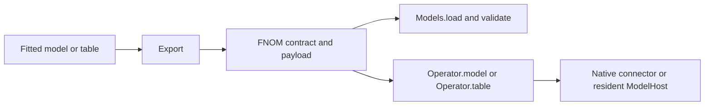

# FNOM artefact API

`fno.Export.sklearn()`, `fno.Export.equinox()`, `fno.Export.onnx()`, and `fno.Export.table()` create self-contained `.fnom` files. `fno.Operator.model()` declares an executable model and `fno.Operator.table()` declares a data-only lookup table; inspection returns metadata rather than raw backend bytes.



## API index

| API | Purpose | Returns |
| --- | --- | --- |
| `fno.Tensor.scalar()` | Declare one scalar port | `Tensor` |
| `fno.Tensor.vector()` | Declare a fixed-width vector port | `Tensor` |
| `fno.Tensor.tensor()` | Declare a fixed-width tensor port | `Tensor` |
| `fno.Export.sklearn()` | Export a fitted sklearn-compatible estimator | `.fnom` `Path` |
| `fno.Export.onnx()` | Export an ONNX model | `.fnom` `Path` |
| `fno.Export.equinox()` | Export an Equinox PyTree | `.fnom` `Path` |
| `fno.Export.table()` | Export a regular-grid lookup table | `.fnom` `Path` |
| `fno.Models.load()` | Inspect an FNOM manifest without executing its payload | `Models.FnomArtifact` |

## Tensor contracts

```python
fno.Tensor.scalar(*, dtype="float64")
fno.Tensor.vector(*, components=3, dtype="float64")
fno.Tensor.tensor(*, components=9, dtype="float64")
```

| Parameter | Type | Default | Allowed values or constraint |
| --- | --- | --- | --- |
| `components` | `int` | `3` or `9` | Positive packed width; not present on `scalar()` |
| `dtype` | `str` | `"float64"` | `float32` or `float64` |

Every input and output in one artefact must use the same `dtype`. Mapping insertion order defines packed port order and each logical name must match the binding used by `Closure` or `Transform`.

## Supported backends

| Export | Backend | Execution |
| ------ | ------- | --------- |
| `Export.sklearn()` | Compiled, native forest, or Joblib | Native C++ or resident Python |
| `Export.onnx()` | ONNX | Native ONNX Runtime |
| `Export.equinox()` | Equinox | Resident JAX |
| `Export.table()` | Regular-grid table | Native multilinear interpolation |

`Export.sklearn()` uses `backend="auto"` by default: supported estimators use the compiled backend and other sklearn-compatible predictors use Joblib. Select `compiled`, `forest`, or `joblib` explicitly only when the deployed representation must be fixed. The native forest backend accepts `ExtraTreesRegressor` and `RandomForestRegressor`; Joblib accepts a fitted object with `predict()` or a callable object.

Joblib models receive a NumPy array by default. Set `input_format="pandas"` or `input_format="polars"` when a model requires a named DataFrame; FoamNordic records the choice in FNOM and constructs columns from the declared scalar input ports in their contract order. These formats require the corresponding optional dependency in the ModelHost environment, while compiled backends retain the NumPy-only native path.

### Compiled estimators

| Family | Models |
| ------ | ------ |
| Linear | `LinearRegression`, `Ridge`, `Lasso`, `ElasticNet` |
| Forest | `ExtraTreesRegressor`, `RandomForestRegressor` |
| Nearest neighbours | `KNeighborsRegressor` |
| Boosting | `GradientBoostingRegressor`, `XGBRegressor`, `XGBRFRegressor`, `LGBMRegressor` |
| Ensemble | `VotingRegressor` composed only of supported models |

The compiled lowering currently emits one numerical value per estimator. This concerns the packed model output width, not OpenFOAM's `volScalarField` type. A one-value prediction can be bound to a compatible scalar field, while Joblib, ONNX, and Equinox support wider model outputs. In normal use an ML engineer can leave `backend="auto"` selected and let unsupported models fall back to Joblib.

### `Export.sklearn`

```python
fno.Export.sklearn(model, *, path, inputs, outputs, name=None,
                   x_scaler=None, y_scaler=None, backend="auto",
                   runtime="sklearn", input_format="numpy", verbose=False)
```

| Parameter | Type | Default | Allowed values or constraint |
| --- | --- | --- | --- |
| `model` | object | required | Fitted supported estimator, object with `predict()`, or callable Joblib payload |
| `path` | path | required | Destination ending in `.fnom` |
| `inputs` | `Mapping[str, Tensor]` | required | Non-empty ordered input contract |
| `outputs` | `Mapping[str, Tensor]` | required | Non-empty ordered output contract |
| `name` | `str \| None` | `None` | Non-empty artefact name; destination stem when omitted |
| `x_scaler` | object or `None` | `None` | Supported fitted affine input scaler |
| `y_scaler` | object or `None` | `None` | Supported fitted affine output scaler |
| `backend` | `str` | `"auto"` | `auto`, `compiled`, `forest` or `joblib` |
| `runtime` | `str` | `"sklearn"` | `sklearn` or `sklearnex`; applies only to Joblib |
| `input_format` | `str` | `"numpy"` | `numpy`, `pandas` or `polars`; compiled backends require `numpy` |
| `verbose` | `bool` | `False` | Display the completed artefact summary |

`pandas` and `polars` formats require scalar input ports and the corresponding library in the ModelHost environment. FoamNordic does not install either library as a mandatory dependency.

```python
artifact = fno.Export.sklearn(
    model,
    path="smagorinsky.fnom",
    inputs={"features": fno.Tensor.vector(components=10)},
    outputs={"nut": fno.Tensor.scalar()},
    x_scaler=scaler_X,
)
```

The first compiled load creates and caches a target-specific native library. XGBoost and LightGBM are required only while exporting their fitted models, and the resulting compiled FNOM does not depend on either runtime. Use `foamnordic compile smagorinsky.fnom` to warm the cache when the login and compute nodes share the same target ABI. The `runtime` argument applies only to Joblib and selects `sklearn` or `sklearnex`.

### Scalers

`x_scaler` and `y_scaler` accept fitted `StandardScaler`, `MinMaxScaler`, `MaxAbsScaler`, `RobustScaler`, or a shape-preserving affine `FunctionTransformer`. Custom affine scaler types can be registered with `bindnordic.scalers.register_scaler_adapter()`. FoamNordic stores the resulting gain and bias in FNOM, transforms inputs before inference, and reverses output scaling before field commit. Nonlinear and feature-mixing transforms are not representable by this native scaler contract.

### `Export.onnx`

```python
fno.Export.onnx(model, *, path, inputs, outputs, name=None,
                x_scaler=None, y_scaler=None, verbose=False)
```

`model` may be an object exposing `SerializeToString()`, raw bytes, or a path accepted by the ONNX payload writer. `path`, `inputs`, `outputs`, `name`, scalers and `verbose` follow `Export.sklearn`. ONNX execution requires the native ONNX connector selected by `foamnordic build`; exporting an artefact does not execute it.

### `Export.equinox`

```python
fno.Export.equinox(model, *, path, inputs, outputs, name=None,
                   batched=False, x_scaler=None, y_scaler=None,
                   verbose=False)
```

| Parameter | Type | Default | Meaning |
| --- | --- | --- | --- |
| `model` | object | required | Reconstructable Equinox PyTree |
| `batched` | `bool` | `False` | `True` when the model already accepts a leading batch dimension; otherwise ModelHost vectorises it |

All remaining parameters follow `Export.sklearn`. Equinox payloads execute in a resident JAX worker and are classified as code-bearing.

## Inspecting an artefact

```python
import foamnordic as fno

artifact = fno.Models.load("reaction-rate.fnom")

print(artifact.name)
print(artifact.backend)
print(artifact.inputs)
print(artifact.outputs)
print(artifact.trust_policy)

artifact.validate()
```

`FnomArtifact` is immutable. `validate()` re-reads the file through the native FNOM parser without importing or executing its embedded backend payload. Joblib, Equinox, and portable C++ payloads are classified as code-bearing; ONNX, native forest, and regular-grid table payloads are classified as data-only. `foamnordic inspect` reports this distinction. Calling `Operator.model()` or `foamnordic compile` is the execution decision; no redundant trust flag is required.

OpenFOAM scalar precision and model precision may differ. The native exchange boundary accepts `float32` and `float64` model contracts with either single- or double-precision OpenFOAM, and performs the required conversion while packing inputs and committing outputs. Equal-precision fields keep the direct copy path; a precision conversion is necessarily not zero-copy.

The equivalent CLI commands are:

```console
foamnordic inspect reaction-rate.fnom
foamnordic inspect reaction-rate.fnom --json
foamnordic validate reaction-rate.fnom
foamnordic diff reference.fnom candidate.fnom
foamnordic diff reference.fnom candidate.fnom --json
```

`diff` validates both artefacts, compares their complete execution manifests and streams embedded or external payloads through SHA-256. File names, external payload paths, and container padding do not affect equivalence, and neither model payload is executed.

See the [FNOM format specification](../architecture/fnom.md) for binary layout and trust boundaries.

## Regular-grid tables

`table()` stores ordered scalar coordinate axes and one dense output array. The last value dimension is the packed width of the declared outputs. BindNordic performs multilinear interpolation natively; no Python process or domain library is present in the solver loop.

```python
artifact = fno.Export.table(
    {"progress": c_axis, "variance": g_axis},
    manifold,
    path="manifold.fnom",
    outputs={"state": fno.Tensor.vector(components=8)},
    bounds={"progress": "clamp", "variance": "error"},
)

operator = fno.Operator.table(artifact)
```

```python
fno.Export.table(axes, values, *, path, outputs, name=None,
                 dtype="float64", bounds="clamp", verbose=False)
```

| Parameter | Type | Default | Allowed values or constraint |
| --- | --- | --- | --- |
| `axes` | `Mapping[str, array-like]` | required | Non-empty ordered scalar axes; every axis finite and strictly increasing |
| `values` | array-like | required | Dense grid whose leading dimensions match axis lengths and whose final packed width matches `outputs` |
| `path` | path | required | Destination ending in `.fnom` |
| `outputs` | `Mapping[str, Tensor]` | required | Non-empty ordered output contract |
| `name` | `str \| None` | `None` | Destination stem when omitted |
| `dtype` | `str` | `"float64"` | `float32` or `float64` |
| `bounds` | `str \| Mapping[str, str]` | `"clamp"` | Global or per-axis `clamp` or `error` policy |
| `verbose` | `bool` | `False` | Display the completed artefact summary |

Axis order is the input contract. Output names and widths are the output contract. The table is domain-neutral: thermochemical manifolds, material properties, control maps, and other regular-grid data use the same artefact and kernel. Each axis must be finite and strictly increasing. Bounds may be `clamp` or `error`, globally or per axis.

## `Models.FnomArtifact`

| Member | Type or signature | Meaning |
| --- | --- | --- |
| `path` | `Path` | Resolved FNOM path |
| `name` | `str` | Logical artefact name |
| `backend` | `str` | Stored model format |
| `format` | `str` | Stored model format as written in the manifest |
| `inputs` | `tuple[TensorContract, ...]` | Ordered input ports |
| `outputs` | `tuple[TensorContract, ...]` | Ordered output ports |
| `runtime` | `str \| None` | Requested backend runtime |
| `input_format` | `str` | Model input container format |
| `input_scaler` | `str \| None` | Embedded affine input scaler kind |
| `output_scaler` | `str \| None` | Embedded affine output scaler kind |
| `bundled` | `bool` | Whether the payload is embedded in the container |
| `payload_offset` | `int \| None` | Byte offset of the embedded payload |
| `payload_size` | `int \| None` | Embedded payload size in bytes |
| `executable_payload` | `bool` | Whether loading the payload may execute supplied code |
| `trust_policy` | `str` | `data-only` or `explicit-trust-required` |
| `size` | `int` | Complete FNOM size in bytes |
| `validate()` | `FnomArtifact` | Re-read and validate the complete container without executing the payload |

Each `TensorContract` exposes `name`, `components` and `dtype` in packed order.
