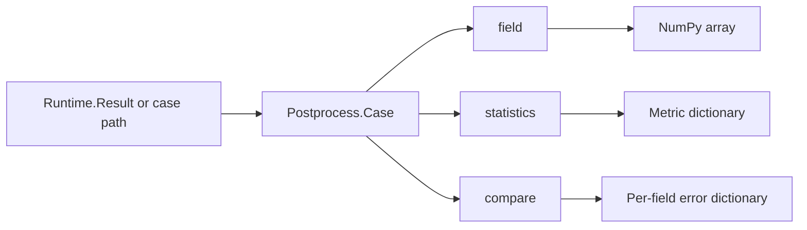

# Postprocess API

`fno.Postprocess` reads durable OpenFOAM results after a local or scheduled run. It is deliberately separate from `run.observe()`: observations are bounded live summaries, while postprocessing reads full stored fields without affecting solver progress.



## API index

| API | Purpose | Returns |
| --- | --- | --- |
| `fno.Postprocess.Case(source)` | Open a stored OpenFOAM result | `Postprocess.Case` |
| `case.field(...)` | Read one internal field | `numpy.ndarray` |
| `case.statistics(...)` | Calculate scalar or magnitude statistics | Metric dictionary |
| `fno.Postprocess.compare(...)` | Compare matching fields from two cases | Per-field metric dictionary |

## Open a result or case

```python
post = fno.Postprocess.Case(result)

# Paths, fno.OpenFOAM.Case declarations, and Result objects are accepted.
same = fno.Postprocess.Case(result.case)
```

`result.postprocess` is the equivalent compact shortcut. `result.case`, `result.logs`, and `result.artifacts` expose stable generated locations without copying files into Python.

### `Postprocess.Case`

```python
fno.Postprocess.Case(source)
```

| Parameter | Type | Constraint |
| --- | --- | --- |
| `source` | path, `OpenFOAM.Case` or `Runtime.Result` | Must resolve to a stored reconstructed or decomposed OpenFOAM case |

| Property | Type | Meaning |
| --- | --- | --- |
| `path` | `Path` | Resolved case directory |
| `times` | `tuple[float, ...]` | Numerically sorted available physical times |

## Select one stored time

```python
latest_u = post.field("U")                 # time_idx=-1 by default
first_u = post.field("U", time_idx=0)
at_one = post.field("U", physical_time=1.0)
```

```python
post.field(name, *, time_idx=None, physical_time=None)
```

| Parameter | Type | Default | Constraint |
| --- | --- | --- | --- |
| `name` | `str` | required | Stored OpenFOAM field name |
| `time_idx` | `int \| None` | `None` | Numerically sorted position; negative indices are accepted |
| `physical_time` | `float \| None` | `None` | Exact available physical time |

`time_idx` addresses the numerically sorted stored times and accepts negative indices. `physical_time` selects the matching OpenFOAM physical time. They are mutually exclusive; passing both is an error. `post.times` returns every available physical time.

Reconstructed and `processor*` cases are supported. Uniform fields are expanded to the mesh cell count, while scalar, vector, symmetric-tensor, and tensor component shapes are retained. BindNordic decodes stored OpenFOAM fields after FoamNordic expands native dictionary directives with the selected OpenFOAM toolchain.

## Statistics

```python
statistics = post.statistics(
    ["U", "p", "nut"],
    time_idx=-1,
    verbose=True,
)
```

```python
post.statistics(fields, *, time_idx=None, physical_time=None, verbose=False)
```

| Parameter | Type | Default | Constraint |
| --- | --- | --- | --- |
| `fields` | `str \| Iterable[str]` | required | One field name or a non-empty collection |
| `time_idx` | `int \| None` | `None` | Mutually exclusive with `physical_time` |
| `physical_time` | `float \| None` | `None` | Mutually exclusive with `time_idx` |
| `verbose` | `bool` | `False` | Display the returned values in a compact table |

The result contains `min`, `max`, `mean`, `std`, and `rms`. Vector and tensor fields use the Euclidean or Frobenius magnitude of each cell. The calculation is always returned as ordinary dictionaries. `verbose=True` additionally displays a compact Onsaemiro table; the default is quiet.

## Compare OpenFOAM and FNO-coupled results

```python
metrics = fno.Postprocess.compare(
    reference=baseline_result,
    candidate=ml_result,
    fields=["U", "p", "nut"],
    physical_time=1.0,
    mesh="strict",
    verbose=True,
)
```

```python
fno.Postprocess.compare(reference, candidate, *, fields, time_idx=None,
                        physical_time=None, mesh="strict", verbose=False)
```

| Parameter | Type | Default | Allowed values or constraint |
| --- | --- | --- | --- |
| `reference` | path, `OpenFOAM.Case` or `Runtime.Result` | required | Baseline case |
| `candidate` | path, `OpenFOAM.Case` or `Runtime.Result` | required | Candidate case |
| `fields` | `str \| tuple[str, ...] \| list[str]` | required | One or more matching fields |
| `time_idx` | `int \| None` | `None` | Matching stored-time position |
| `physical_time` | `float \| None` | `None` | Matching physical time; mutually exclusive with `time_idx` |
| `mesh` | `str` | `"strict"` | `strict` or `shape` |
| `verbose` | `bool` | `False` | Display the comparison table |

For field vectors $\mathbf{r}$ and $\mathbf{c}$ with $N$ stored values, the reported errors are

$$
\operatorname{MAE}=\frac{1}{N}\sum_{i=1}^{N}|c_i-r_i|,
\qquad
\operatorname{RMSE}=\sqrt{\frac{1}{N}\sum_{i=1}^{N}(c_i-r_i)^2},
$$

$$
L_{2,\mathrm{rel}}=\frac{\lVert\mathbf{c}-\mathbf{r}\rVert_2}{\lVert\mathbf{r}\rVert_2}.
$$

When the reference norm is zero, `relative_l2` is `0.0` for an identical candidate and infinity otherwise.

Each field reports `mae`, `rmse`, `max_abs`, and `relative_l2`. The default `mesh="strict"` verifies reconstructed mesh files or matching decomposed mesh and `cellProcAddressing` files before cell-wise comparison. `mesh="shape"` is an explicit diagnostic mode for cases where only field shapes are known to correspond; it cannot detect reordered cells.

Plotting remains ordinary NumPy, Matplotlib, PyVista, or another user-selected tool. Postprocess owns reliable field access and numerical comparison rather than a second plotting framework.
