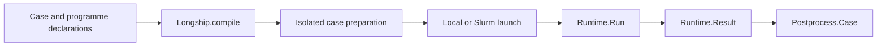

# Run control API

FoamNordic describes a workload with immutable declarations and returns a non-blocking Run. The source case is copied before any preparation command.



## API index

| API | Purpose | Returns |
| --- | --- | --- |
| `fno.OpenFOAM.Case(...)` | Declare a source case, run location and OpenFOAM environment | `OpenFOAM.Case` |
| `case.initialize(...)` | Declare mesh validation or generation for the isolated run | The same `Case` |
| `fno.Operator.model(...)` | Use an executable FNOM model | `Operator` |
| `fno.Operator.table(...)` | Use a regular-grid FNOM table | `Operator` |
| `fno.Operator.function(...)` | Use a Python function or solver-native symbolic graph | `Operator` |
| `fno.Closure(...)` | Bind an operator to a solver-side closure adapter | `Closure` |
| `closure.update(...)` | Append an immutable solver-mediated update stage | New `Closure` |
| `fno.Transform(...)` | Bind an operator to a generic field-update stage | `Transform` |
| `fno.Observe(...)` | Request bounded field summaries | `Observe` |
| `fno.Longship(...)` | Assemble one complete workload | `Longship` |
| `longship.launch(...)` | Prepare and launch the workload | `Runtime.Run` |

## Case

```python
from pathlib import Path
import foamnordic as fno

case = fno.OpenFOAM.Case(
    name="lidDrivenCavity",
    case_dir=Path("cases/lidDrivenCavity"),
    run_dir=Path("output"),
    of_cmd="openfoam/2512",
    application="pimpleFoam",
)
case.initialize(ranks=1, mesh="blockMesh", validate_mesh=True)
```

`of_cmd` may be an environment module shorthand or an explicit shell command. `mesh=None` uses an existing mesh. If `0/` is absent, `0.orig/` is copied into the isolated case.

### `OpenFOAM.Case`

```python
fno.OpenFOAM.Case(*, name=None, case_dir, run_dir, of_cmd=None,
                  shell="bash", application="pimpleFoam", ranks=1,
                  integration=None)
```

| Parameter | Type | Default | Allowed values or constraint |
| --- | --- | --- | --- |
| `name` | `str \| None` | `None` | Non-empty run label; inferred from `case_dir` when omitted |
| `case_dir` | path | required | Existing source case; must differ from `run_dir` |
| `run_dir` | path | required | Parent output location for isolated runs |
| `of_cmd` | `str \| None` | `None` | Module name, shell initialisation command, OpenFOAM.app wrapper or commands already on `PATH` |
| `shell` | `str` | `"bash"` | Executable resolving to `bash` or `zsh` |
| `application` | `str` | `"pimpleFoam"` | Non-empty OpenFOAM executable name or path |
| `ranks` | `int` | `1` | Positive integer |
| `integration` | `OpenFOAM.DictionaryTemplate \| None` | `None` | Optional out-of-tree adapter dictionary template |

```python
case.initialize(*, ranks=None, mesh=None, validate_mesh=False)
```

| Parameter | Type | Default | Allowed values or constraint |
| --- | --- | --- | --- |
| `ranks` | `int \| None` | `None` | Positive integer; retains the constructor value when omitted |
| `mesh` | `str \| None` | `None` | `None` or `"blockMesh"` |
| `validate_mesh` | `bool` | `False` | Runs `checkMesh` during isolated preparation when true |

### Case inspection

| Member | Type or signature | Meaning |
| --- | --- | --- |
| `initial_directory` | `Path` | `0/` when present, otherwise `0.orig/` |
| `fields` | `Mapping[str, OpenFOAM.Field]` | Lazily decoded initial fields |
| `boundary_names` | `tuple[str, ...]` | Sorted unique initial-field patch names |
| `field(name)` | `OpenFOAM.Field` | Return one field or raise an error listing the available names |

Each `OpenFOAM.Field` record exposes `name`, `field_class`, `dimensions`, `internal_value`, `boundary_names` and `path`. Native OpenFOAM dictionary directives are expanded through the selected toolchain before decoding.

### Custom integration dictionary

```python
fno.OpenFOAM.DictionaryTemplate(source, destination, variables={})
```

| Parameter | Type | Default | Constraint |
| --- | --- | --- | --- |
| `source` | path | required | Existing template resolved by the case preparation stage |
| `destination` | path | required | Relative path that remains inside the isolated case |
| `variables` | `Mapping[str, str]` | `{}` | Non-empty variable names mapped to rendered string values |

Pass the declaration as `Case(integration=...)` for an out-of-tree solver adapter. FoamNordic supplies its runtime variables and combines them with `variables`; the adapter retains ownership of solver-specific call sites and equations.

## Models and field programs

```python
transform = fno.Transform(
    name="predictVelocity",
    operator=fno.Operator.model("velocity.fnom"),
    inputs={"pressure": fno.Field("p")},
    outputs={"velocity": fno.Field("U")},
    at="time_step_start",
)

closure = fno.Closure(
    name="nutFjord",
    operator=fno.Operator.model("eddy-viscosity.fnom"),
    inputs={
        "velocity_grad": fno.Field.grad("U"),
        "delta": fno.Field.delta(),
    },
    outputs={"nut": fno.Field("nut")},
)
```

`Transform` is a generic stored-field operation. `Closure` requires a solver-side equation adapter. FNOM selects ONNX, compiled, Joblib, Equinox, or a native table without changing this interface.

One physical closure may contain a later solver-mediated field update without introducing another top-level workflow object. `update()` is immutable: it returns a new declaration and leaves the original closure unchanged. Each stage receives its own resident worker, while the custom OpenFOAM integration template fixes the actual solver call sites and places `@FOAMNORDIC_UPDATE_0_BODY@` where the first update is invoked.

```python
closure = fno.Closure(
    name="progressRateFjord",
    operator=fno.Operator.model("reaction-rate.fnom"),
    inputs={
        "c": fno.Field("c"),
        "c_var": fno.Field("cVar"),
        "T": fno.Field("T"),
    },
    outputs={"omega_c": fno.Field("omega_c")},
)

closure = closure.update(
    name="thermochemicalState",
    operator=fno.Operator.table("manifold.fnom"),
    inputs={
        "c": fno.Field("c"),
        "c_var": fno.Field("cVar"),
    },
    outputs={
        "H2": fno.Field("H2"),
        "O2": fno.Field("O2"),
        "H2O": fno.Field("H2O"),
        "N2": fno.Field("N2"),
    },
)
```

`Operator.table()` deliberately states that an FNOM artefact is a lookup table. FoamNordic checks this declaration against the manifest before launch. The ordered update list describes ownership and worker lifetime, not numerical composition: the solver adapter remains responsible for advancing equations between stages.

Pure mathematical functions can use `Operator.function`; logical inputs become keyword arguments and returned mapping keys are logical outputs.

### Operators and field programmes

```python
fno.Operator.model(path)
fno.Operator.table(path)
fno.Operator.function(function)
```

| Constructor | Argument | Constraint | Execution |
| --- | --- | --- | --- |
| `model` | `.fnom` path | Manifest must describe an executable model | Native connector or resident ModelHost selected by the artefact |
| `table` | `.fnom` path | Manifest must describe a regular-grid table | Native multilinear lookup |
| `function` | callable | Logical inputs must match callable parameters | Native OpenFOAM graph when fully supported; otherwise resident Python |

```python
fno.Closure(name, operator=None, inputs=None, outputs=None, key=None, *, artifact=None)
fno.Transform(name, operator, inputs=None, outputs=None,
              at="time_step_start", key=None)
```

| Parameter | Applies to | Default | Allowed values or constraint |
| --- | --- | --- | --- |
| `name` | `Closure` | required | Non-empty adapter name; names must be unique within a `Longship` |
| `name` | `Transform` | required | Non-empty OpenFOAM word; names must be unique within a `Longship` |
| `operator` | Both | required¹ | `Operator`; legacy `artifact=` remains accepted by `Closure` |
| `inputs` | Both | `None` | Mapping from logical model names to `FieldExpression`; inferred for recognised FNOM contracts when omitted |
| `outputs` | Both | `None` | Mapping from logical model names to mutable OpenFOAM fields; inferred for recognised FNOM contracts when omitted |
| `key` | Both | `None` | `Random.Key`; deterministic global key 42 when omitted |
| `at` | `Transform` | `"time_step_start"` | `time_step_start`, `outer_corrector`, `pressure_corrected`, `time_step_end` |

¹ Use `artifact=` only for compatibility; new code should always pass an `Operator`.

## Local launch

```python
longship = fno.Longship(
    case=case,
    transforms=(transform,),
    numerics="strict",  # optional; default is convenient
)
run = longship.launch(start_timeout=900, profile_every=0)
result = run.stop(timeout=3600, progress=True)
result.summary(style="compact")
```

With no scheduler, rank one runs directly and multiple ranks use the MPI launcher associated with the case environment.

## Slurm launch

```python
scheduler = fno.Slurm(
    account="project_0000000",
    partition="small",
    time="00:30:00",
    openfoam=fno.Slurm.openfoam(
        nodes=1, ntasks=16, cpus_per_task=1, mem_per_cpu="2G"
    ),
    model=fno.Slurm.model(cpus_per_task=4, mem_per_cpu="2G"),
)

case.initialize(ranks=16, mesh=None, validate_mesh=True)
run = fno.Longship(
    case=case, scheduler=scheduler, closures=(closure,)
).launch(start_timeout=900)
```

Solver and model resources are separate. Coupled jobs place a resident model worker on every solver node and fail together inside one allocation.

### `Slurm`

```python
fno.Slurm(account, partition, time, *, openfoam, model=None)
fno.Slurm.openfoam(*, nodes, ntasks, cpus_per_task=1, mem_per_cpu=None)
fno.Slurm.model(
    *,
    cpus_per_task=1,
    mem_per_cpu=None,
    gres_model=None,
    gres_count=None,
)
```

| Parameter | Applies to | Default | Constraint |
| --- | --- | --- | --- |
| `account` | `Slurm` | required | Non-empty Slurm account without whitespace |
| `partition` | `Slurm` | required | Non-empty Slurm partition without whitespace |
| `time` | `Slurm` | required | Non-empty Slurm time limit without whitespace |
| `openfoam` | `Slurm` | required | Value returned by `Slurm.openfoam()` |
| `model` | `Slurm` | `None` | Value returned by `Slurm.model()`; one ModelHost task is placed on each OpenFOAM node |
| `nodes` | `Slurm.openfoam` | required | Positive integer |
| `ntasks` | `Slurm.openfoam` | required | Positive integer divisible by `nodes` |
| `cpus_per_task` | Both resource declarations | `1` | Positive integer |
| `mem_per_cpu` | Both resource declarations | `None` | Non-empty Slurm memory value without whitespace, such as `"2G"` |
| `gres_model` | Model resources | `None` | GPU model requested for each ModelHost node, such as `"gh200"` |
| `gres_count` | Model resources | `None` | Positive GPU count per ModelHost node; declared together with `gres_model` |

Declaring model memory requires `mem_per_cpu` on the OpenFOAM resources as well, because both steps share the allocation request. Omitting `model` retains the default one-CPU ModelHost resources without emitting an explicit model resource section.

Model GRES resources are reserved on every OpenFOAM node and assigned only to the ModelHost step. For example, `gres_model="gh200", gres_count=1` renders `--gres=gpu:gh200:1` for the allocation and ModelHost launch.

### Placement

```python
fno.Runtime.Attached(model_cpus_per_node=None, data_path="auto")
```

| Parameter | Type | Default | Allowed values or constraint |
| --- | --- | --- | --- |
| `model_cpus_per_node` | `int \| None` | `None` | Positive integer, or automatic selection when omitted |
| `data_path` | `str` | `"auto"` | `auto`, `shm`, `uds`, `ucx` or `tcp` |

Attached placement starts one ModelHost beside the solver ranks on each node. `auto` selects the fastest available path compatible with the actual placement; an explicit path turns an unavailable transport into a launch error rather than silently changing it.

## Observations

`Observe` requests bounded native summaries at a declared interval. Observation records are monitoring data and never gate solver progress. Stored fields and full scientific comparison belong to `Result.postprocess`.

```python
fno.Observe(summaries, interval=1)
```

| Parameter | Type | Default | Allowed values or constraint |
| --- | --- | --- | --- |
| `summaries` | `Mapping[str, tuple[str, ...]]` | required | At least one field; reductions are `min`, `max`, `mean` and `l2` |
| `interval` | `int` | `1` | Positive number of completed field-programme exchanges |

### Observation records

```python
for record in run.observe(poll_interval=0.1, progress=False):
    print(record.exchange_index, record.time, record.summary["U"].l2)
```

| Type | Members |
| --- | --- |
| `Runtime.ObservationRecord` | `exchange_index`, `time`, `summary`, `timing` |
| `Runtime.FieldSummary` | `minimum`, `maximum`, `mean`, `l2`, `count`; unrequested values are `None` |
| `Runtime.ObservationTiming` | `model_wait`, `evaluate` in seconds |
| `Runtime.ObservationStream` | Iterable stream with `path`, `poll_interval`, `expected_sources` and `close()` |

Multi-rank records are merged by exchange index. `ObservationStream.close()` stops only local consumption; it neither cancels the workload nor deletes retained records.

## `Longship`

```python
fno.Longship(case, closures=(), transforms=(), observations=(),
             placement=fno.Runtime.Attached(), scheduler=None, name=None,
             verbose=False, numerics="convenient")
```

| Parameter | Type | Default | Allowed values or constraint |
| --- | --- | --- | --- |
| `case` | `OpenFOAM.Case` | required | Case declaration owned by this workload |
| `closures` | `tuple[Closure, ...]` | `()` | Solver-adapter programmes |
| `transforms` | `tuple[Transform, ...]` | `()` | Generic field programmes |
| `observations` | `tuple[Observe, ...]` | `()` | Read-only summaries |
| `placement` | `Runtime.Attached` | automatic | One ModelHost per solver node; `data_path` is `auto`, `shm`, `uds`, `ucx` or `tcp` |
| `scheduler` | `Slurm \| None` | `None` | Local execution when omitted |
| `name` | `str \| None` | `None` | Inferred from `case.name` when omitted |
| `verbose` | `bool` | `False` | Display declaration and launch information |
| `numerics` | `str` | `"convenient"` | `convenient` may add missing derived-field schemes to the copied case; `strict` rejects them |

```python
longship.launch(*, readiness_timeout=120.0, termination_grace=30.0,
                orphan_timeout=30.0, start_timeout=None, verbose=None,
                profile_every=0, receive_memory_bytes=None)
```

| Parameter | Type | Default | Meaning |
| --- | --- | --- | --- |
| `readiness_timeout` | `float` | `120.0` | Positive seconds allowed for ModelHost readiness |
| `termination_grace` | `float` | `30.0` | Positive seconds allowed for coordinated child shutdown |
| `orphan_timeout` | `float` | `30.0` | Non-negative seconds before cancelling after owner loss; `0` requests immediate cancellation |
| `start_timeout` | `float \| None` | `None` | Positive seconds to wait for scheduler start; unlimited when omitted |
| `verbose` | `bool \| None` | `None` | Overrides `Longship.verbose`; `None` inherits it |
| `profile_every` | `int` | `0` | Profile every N exchanges; `0` disables profiling |
| `receive_memory_bytes` | `int \| None` | `None` | Positive shared pre-receive memory credit; automatically budgeted when omitted |

## Run ownership

- `run.status` reads current state.
- `run.stop()` waits for normal completion.
- `run.stop(force=True)` requests bounded cancellation.
- `run.detach()` allows the workload to outlive Python ownership.
- `result.artifacts` exposes the isolated case, logs, observations, and Slurm files.

Closing an owning Python process cancels its active workload after the orphan timeout. A detached run must be managed through its scheduler or supervisor.

### `Runtime.Run`

| Member | Signature or type | Behaviour |
| --- | --- | --- |
| `status` | `Runtime.RunStatus` | Non-blocking current state |
| `summary` | `summary(style="compact", *, display=True)` | Return current local or Slurm metadata; styles are `short`, `compact`, `long` and `expanded` |
| `observe` | `observe(*, poll_interval=0.1, progress=False)` | Return a streaming iterator of merged observation records |
| `stop` | `stop(*, force=False, timeout=None, progress=False)` | Wait for completion or request bounded cancellation; always returns the same terminal `Result` |
| `detach` | `detach()` | Release Python ownership and return the same `Run` |

`RunStatus` values are `running`, `succeeded`, `failed` and `cancelled`. A non-forced `stop()` does not cancel at `timeout`; it raises `TimeoutError` while the workload remains owned and running.

### `Runtime.Result`

| Member | Type or signature | Meaning |
| --- | --- | --- |
| `status` | `Runtime.RunStatus` | Terminal lifecycle state |
| `success` | `bool` | True only for `succeeded` |
| `exit_code` | `int` | Supervisor exit code |
| `elapsed_seconds` | `float` | Measured wall-clock duration |
| `work_dir` | `Path` | Generated run root |
| `case` | `Path` | Isolated OpenFOAM case |
| `logs` | `Path` | Run log directory |
| `artifacts` | `Runtime.ResultArtifacts` | Stable case, log, observation and Slurm paths |
| `postprocess` | `Postprocess.Case` | Durable field reader for this result |
| `job_id` | `str \| None` | Slurm job identifier, or `None` for a local run |
| `plan_digest` | `str \| None` | Digest of the compiled execution plan |
| `summary()` | `summary(style="compact", *, display=True)` | Return a `RunSummary`; styles are `short`, `compact`, `long` and `expanded` |

## Reproducibility

The run marker stores the compiled plan and digest. It includes resources, placement, stages, bindings, random keys, and numerics policy. Convenient numerics records actual dictionary insertions in the run directory.
