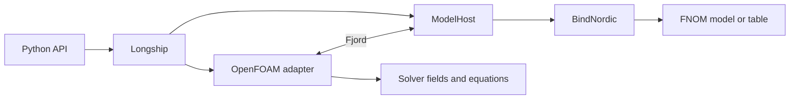

# Architecture

FoamNordic separates workload declaration from repeated solver execution. Python compiles an immutable plan and prepares an isolated case; native components own field access, numerical execution, model evaluation, transport and atomic publication.

OpenFOAM retains equations, correction order, mesh and boundary conditions. Each run stages an isolated copy of the source case. The adapter evaluates native symbolic functions inside OpenFOAM, while ModelHost evaluates FNOM models and tables, including fitted scaling and encoding.

## Component boundaries

| Component | Responsibility | Does not own |
| --- | --- | --- |
| Python API | Workload, field, model, placement and scheduler declarations | Repeated solver execution |
| Longship | Plan compilation, placement, readiness, lifecycle, logs and durable results | Physical equations |
| OpenFOAM adapter | Current field views, equation hooks, topology generation and atomic commit | Model implementation |
| Fjord | Bounded numeric transport and exchange identity | Persistent model or field state |
| Rune | Binary frame representation | Channel selection or solver semantics |
| Harbor | Atomic request and response sequencing | Numerical interpretation |
| ModelHost | Resident process, admission, workspace and backend invocation | Solver progression |
| Smedja | Reusable packing and execution workspace | Cross-request physical state |
| BindNordic | FNOM, tensor contracts, scalers and backend execution | Simulation semantics |
| External solver adapter | Call sites, equations, correction order and physical meaning | Generic model runtime |

## Deployment forms

| Form | Process layout | Normal data path |
| --- | --- | --- |
| Solver-native function | Symbolic graph inside the OpenFOAM adapter | No ModelHost or inter-process exchange |
| Local resident model | OpenFOAM and one ModelHost on the local host | Shared memory with Unix-socket control |
| Slurm attached model | One ModelHost beside solver ranks on each allocated node | Node-local shared memory |

Local and Slurm execution consume the same compiled plan. FNOM is the deployment boundary for model tensors, scaling, backend metadata and payloads; placement changes do not alter the field contract.

## Failure semantics

| Boundary | Required behaviour |
| --- | --- |
| Declaration | Reject invalid types, names and incompatible contracts before launch when possible |
| Admission | Reserve the complete request before accepting tensor bodies |
| Evaluation | Keep model failure outside solver-owned field storage |
| Publication | Validate every output and commit all destinations atomically |
| Coupled lifecycle | Terminate peers when one required component fails |
| Cleanup | Remove only paths carrying valid FoamNordic ownership markers |

## Reproducibility

The compiled plan records field bindings, stages, resources, placement, random keys and numerics policy. Strict numerics rejects a missing OpenFOAM scheme. Convenient numerics adds only a required missing scheme to the isolated case and records the exact change.

## Performance objective

The engineering target is an FNO-coupled/OF/FNO wall-time ratio of $1.5\times$–$1.8\times$ for matched cases, meshes, decompositions and allocations. Report the model, transport, hardware and measurement method with each benchmark.

## Non-goals

Users define the physical meaning of model ports and train models in their own workflow. OpenFOAM handles mesh distribution.

## Architecture reference

| Document | Contract |
| --- | --- |
| [OpenFOAM integration](openfoam.md) | Fields, topology, closures, numerics, and external adapters |
| [Native runtime](runtime.md) | Admission, workspaces, backend capabilities, and atomic output |
| [Native transport](transport.md) | Rune frames, Harbor exchanges, channels, and memory credit |
| [FNOM](fnom.md) | Artefact contents, backend selection, validation, and trust |
| [Execution lifecycle](lifecycle.md) | Local and Slurm launch, ownership, shutdown, and generations |
| [Observations](observations.md) | Read-only monitoring, retention, and backpressure |
| [Package boundary](../../packages/README.md) | Model execution and simulation semantics |
