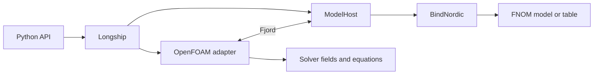

# Architecture

FoamNordic separates workload declaration from repeated solver execution. Python compiles an immutable plan and prepares an isolated case; native components own field access, numerical execution, model evaluation, transport and atomic publication.

No notebook callback, model object or scheduler command appears in the solver exchange loop. The OpenFOAM solver retains ownership of equations, correction order, mesh and boundary conditions; FoamNordic evaluates only the declared operator at an adapter-owned boundary.

## Component boundaries

| Component | Responsibility | Does not own |
| --- | --- | --- |
| Python API | Workload, field, model, placement and scheduler declarations | Repeated solver execution |
| Longship | Plan compilation, placement, readiness, lifecycle, logs and durable results | Physical equations |
| OpenFOAM adapter | Current field views, equation hooks, topology generation and atomic commit | Model implementation |
| Fjord | Bounded numeric transport and exchange identity | Persistent model or field state |
| Rune | Binary frame representation | Channel selection or solver semantics |
| Harbor | Atomic request and response sequencing | Numerical interpretation |
| ModelHost | Resident process, admission, workspace and backend invocation | Solver progression |
| Smedja | Reusable packing and execution workspace | Cross-request physical state |
| BindNordic | FNOM, tensor contracts, scalers and backend execution | Simulation semantics |
| External solver adapter | Call sites, equations, correction order and physical meaning | Generic model runtime |

## Deployment forms

| Form | Process layout | Normal data path |
| --- | --- | --- |
| Solver-native function | Symbolic graph inside the OpenFOAM adapter | No ModelHost or inter-process exchange |
| Local resident model | OpenFOAM and one ModelHost on the local host | Shared memory with Unix-socket control |
| Slurm attached model | One ModelHost beside solver ranks on each allocated node | Node-local shared memory |

Local and Slurm execution consume the same compiled plan. FNOM is the deployment boundary for model tensors, scaling, backend metadata and payloads; placement changes do not alter the field contract.

## Architecture reference

| Document | Contract |
| --- | --- |
| [Design principles](principles.md) | Stable ownership, failure, reproducibility and non-goals |
| [Native runtime](runtime.md) | Admission, workspaces, backend capabilities and atomic output |
| [Native transport](transport.md) | Rune frames, Harbor exchanges, channels and memory credit |
| [FNOM](fnom.md) | Artefact contents, backend selection, validation and trust |
| [OpenFOAM integration](openfoam.md) | Fields, topology, closures, numerics and external adapters |
| [Execution lifecycle](lifecycle.md) | Local and Slurm launch, ownership, shutdown and generations |
| [Observations](observations.md) | Read-only monitoring, retention and backpressure |
| [Package boundary](../../packages/README.md) | Separation between model execution and simulation semantics |
