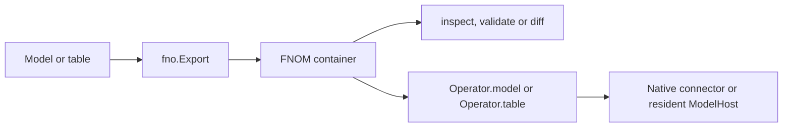

# FNOM model artefacts

FNOM is the deployment artefact for learned models, mathematical estimators and regular-grid tables. BindNordic owns the container, tensor contracts, affine scalers, backend metadata, payload validation and model execution; FoamNordic binds those tensors to the simulation.

FNOM is designed for BindNordic deployment rather than general model interchange. Use the supported `fno.Export` functions to create artefacts; the physical payload encoding may change while the declared model, ports, scaling and numerical behaviour remain compatible.



## Container contract

| Section | Purpose |
| --- | --- |
| Identity | Artefact name, format and runtime |
| Inputs | Ordered logical names, component widths and floating-point dtype |
| Outputs | Ordered logical names, component widths and floating-point dtype |
| Scaling | Optional affine input and output transforms |
| Execution metadata | Backend capabilities and input container format |
| Payload | Embedded model, table or portable compiled source |
| Integrity | Bounds, encoding and payload checks used during validation |

Logical port names and widths are stable across backends. Changing placement or execution backend does not change the OpenFOAM binding declaration.

## Deployment layers

| Layer | Stored content | Lifetime |
| --- | --- | --- |
| Semantic contract | Model kind, ports, dtype, scaling and execution requirements | Stable across supported targets |
| Portable image | Backend payload, packed forest or table arrays | Stored in FNOM |
| Target cache | Compiled library, accelerator index or JIT state | Rebuilt for one target and never treated as artefact semantics |

Native payloads favour validation, alignment and direct access over maximum compression. Uniform table axes store their start, step and count; other axes retain explicit points. Target-specific optimisation belongs in a content-addressed cache derived from the complete artefact and target ABI.

## Backends

| Backend | Execution boundary | Trust classification |
| --- | --- | --- |
| ONNX | Native ONNX Runtime connector | Data-only |
| Compiled estimator | Content-addressed target-native library | Depends on the stored runtime |
| Native forest | Checked C++ tree evaluator | Data-only |
| Regular-grid table | Native multilinear interpolation | Data-only |
| Joblib | Persistent Python resident | Code-bearing |
| Equinox | Persistent JAX resident | Code-bearing |

Compiled estimators and native forests suit modest tree or boosting models. Very large compiled estimators can spend more time and memory in code generation than they recover during inference. Joblib is the general compatibility path and avoids generated C++ compilation, while ONNX and Equinox serve portable native and JAX execution respectively. Production selection should use representative batch sizes and the target host.

## Validation and trust

```console
foamnordic inspect model.fnom
foamnordic validate model.fnom
foamnordic diff reference.fnom candidate.fnom
foamnordic compile model.fnom
```

`inspect`, `validate` and `diff` parse metadata and payload bounds without loading or executing supplied model code. `diff` compares the effective execution manifest and streams payload bytes through SHA-256; file paths and container padding do not affect equivalence. Structural validation and hashes establish integrity, not authorship. Code-bearing artefacts must come from a trusted source.

## Runtime path

The container is validated before worker startup. Native payloads are memory-mapped where supported and remain owned by the loaded model. FoamNordic packs fields by declared name and width, BindNordic applies input scaling and evaluates the backend, and FoamNordic validates layout, dtype and finite values before inverse-scaled outputs are committed atomically. Compiled payloads are cached by content and target ABI.

The public format is documented through the [FNOM API](../api/model-artifact.md). Internal encoding revisions are container implementation details rather than user-visible artefact generations.
