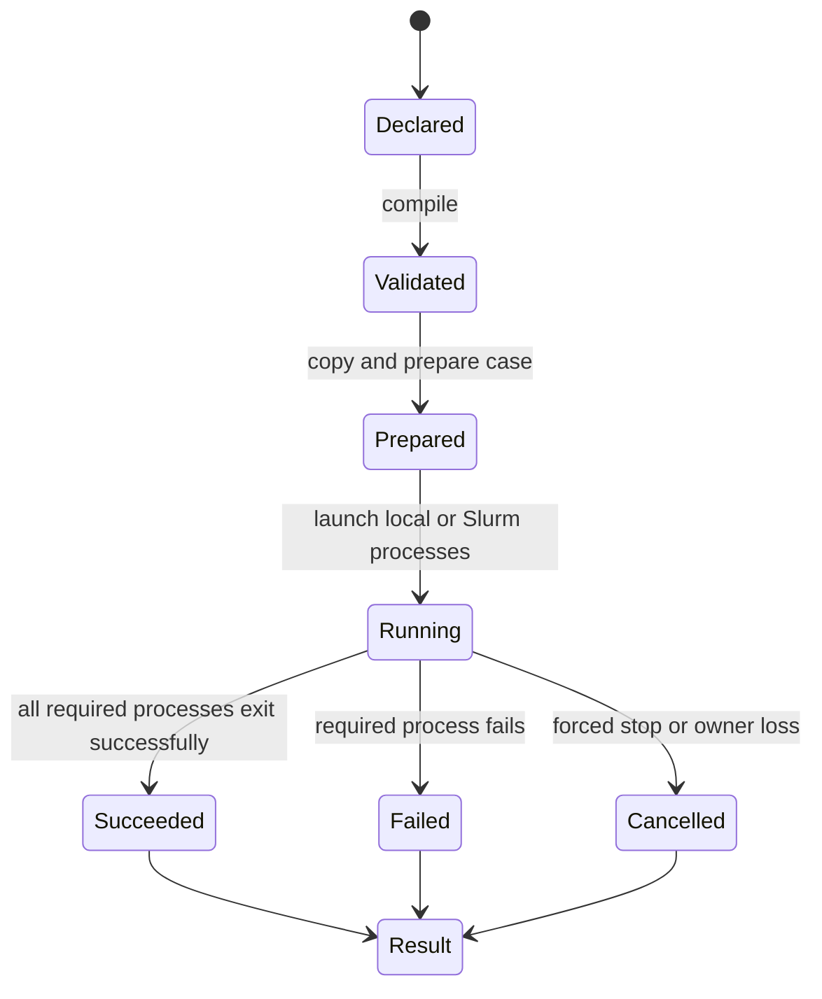

# Execution lifecycle

A Longship workload moves through one explicit lifecycle. Preparation is isolated from the source case, launch is non-blocking and every terminal state produces one durable result.

## Lifecycle stages

| Stage | Operation | Durable output |
| --- | --- | --- |
| Declaration | Assemble case, programmes, observations, placement and scheduler | Python declarations |
| Compilation | Validate contracts and create the deterministic plan digest | Compiled plan |
| Preparation | Copy the case, render dictionaries and run requested mesh checks | Isolated run directory |
| Launch | Start the local supervisor or submit one Slurm allocation | `Runtime.Run` |
| Execution | Coordinate solver ranks, ModelHost processes and observations | Logs and selected observations |
| Completion | Finalise status, paths, timing and scheduler identity | `Runtime.Result` |

## Local and Slurm execution

| Mode | Solver launch | Model placement |
| --- | --- | --- |
| Local, one rank | Direct process | Local ModelHost when required |
| Local, multiple ranks | MPI launcher from the case environment | Local ModelHost when required |
| Slurm | Solver step with declared OpenFOAM resources | One ModelHost task per solver node |

Both modes use the same plan, readiness protocol, failure propagation and result contract.

## Ownership and shutdown

Python owns a run by default. `run.stop()` waits for normal completion, while `run.stop(force=True)` requests bounded cancellation. If the owning process disappears, the supervisor cancels the workload after `orphan_timeout`; `run.detach()` explicitly transfers responsibility to the scheduler or supervisor. A required solver or ModelHost failure terminates its peers, but the generated logs and case remain available.

## Runtime generations

`foamnordic build` publishes immutable, content-addressed runtime generations and atomically selects the current generation. A running workload pins its exact generation. Cleanup preserves current, recent, pinned, incomplete and damaged generations and removes only old, complete, unpinned assets.

## Terminal result

A terminal `Runtime.Result` records lifecycle status, exit code, elapsed time, job identity, plan digest and stable paths to the isolated case, logs, observations and Slurm files. `result.postprocess` opens the run-owned case without copying full fields into the control process.
