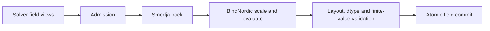

# Native runtime

One ModelHost per assigned node executes resident field programmes outside OpenFOAM. Each programme retains its artefact, endpoint, kernel and backend state; all share node-local execution capacity. Python prepares plans and artefacts but is not called during exchanges.

## Request path

A request is identified by exchange index, solver time index, topology generation, physical time, rank, tensor contract, and payload size. Input bodies are accepted only after the complete request fits the receive budget.

## Execution contexts

Each context owns a reusable Smedja workspace. Immutable field layouts are compiled once; field addresses, shapes, and active cells are rebound for every request. Active estimates and retained capacity share one context budget. Oversized idle cache is released rather than blocking new work.

Backends declare whether evaluation is concurrent. Non-concurrent backends use a narrow lock around evaluation only; packing and output handling remain request-local.

Compute-thread ownership and safe concurrent evaluation are separate capabilities. Threadless table lookups can use several CPUs by serving independent rank requests. Resource planning must account for both.

| Capability | Declared meaning |
| --- | --- |
| Compute-thread ownership | Backend reserves the node-local execution budget for one evaluation |
| Concurrent evaluation | Independent requests may execute safely at the same time |
| Input and output memory | `host`, `pinned_host`, `device` or `unified` |
| Completion | Synchronous return or event-based completion |
| Persistent device state | Backend may retain state between requests on the device |
| Workspace recreation | Shape changes require a new workspace when declared |
| Batch and alignment | Preferred row count and byte alignment |

The residency planner classifies boundaries as direct, staged or unsupported. ModelHost currently accepts only direct synchronous host tensors and rejects other plans before execution. An optional connector ABI exposes this contract while retaining compatibility with older host-only plugins.

`StatefulEngineBackend` supports persistent state. `TransactionalEngine` commits state and generation metadata only after a successful `advance()`, with optional checkpoint and restore. Topology changes require reinitialisation unless the backend declares state preservation.

An optional observer reports sizes, timings, retries, fallbacks and device-memory use. It does not redistribute mesh or model work.

A compute-thread-owning backend reserves the full node-local budget during evaluation. Threadless kernels use one capacity unit per request and may run concurrently. Each programme keeps its listener; consolidation adds no broker. Programme failure terminates ModelHost and the supervisor tears down the workload.

## Outputs

Predictions are matched to declared output names and widths. Scaling, numeric conversion, finite-value checks, topology-generation matching, and destination alias checks complete before any solver-owned field changes. Multi-output publication is atomic.

## Request outcomes

| Outcome | Runtime action |
| --- | --- |
| Valid response | Commit every destination atomically |
| Invalid shape, dtype or value | Reject the complete response |
| Model failure or timeout | Invalidate the exchange and terminate required peers |
| Transport loss or cancellation | Wake admission waiters and return memory credit |
| Empty rank | Complete a valid no-op batch without retaining packing storage |

## Bypass and empty ranks

A field programme may evaluate a selected cell subset while deterministic bypass rules fill the remaining cells. Empty rank-local partitions are valid no-op batches and do not retain packing storage.

## Failure behaviour

Malformed input, model failure, invalid output, timeout, transport loss, or cancellation invalidates the exchange. Admission waiters wake, memory credits return, and the coupled supervisor tears down peers within the configured grace period.

## Profiling

`Longship.launch(profile_every=N)` samples the ModelHost and each solver rank once every `N` invocations. On clean shutdown, `Model telemetry` records workload, memory and model-stage costs. Resident `Solver telemetry` records mean request publication, response wait, request-to-response round trip and atomic field commit times. `Native transport telemetry` records pre-solve algebra, matrix assembly, solve, post-solve algebra and field-commit times for `Field.transport` closures.

Response wait includes queueing, model execution and return transport, so it is not a pure network-latency measurement. `profile_every=0` disables telemetry without clock reads, payload scans or sampling-counter updates in either execution path.
