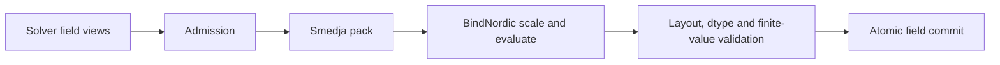

# Native runtime

ModelHost executes every resident field programme outside the OpenFOAM process. One ModelHost process runs on each assigned node; it retains a separate artefact, endpoint, kernel and backend state for every programme while admitting inference through one node-local execution-capacity pool. Python prepares the plan and artefacts but is not called during exchanges.

## Request path

A request is identified by exchange index, solver time index, topology generation, physical time, rank, tensor contract, and payload size. Input bodies are accepted only after the complete request fits the receive budget.

## Execution contexts

Each context owns a reusable Smedja workspace. Immutable field layouts are compiled once; field addresses, shapes, and active cells are rebound for every request. Active estimates and retained capacity share one context budget. Oversized idle cache is released rather than blocking new work.

Backends declare whether evaluation is concurrent. Non-concurrent backends use a narrow lock around evaluation only; packing and output handling remain request-local.

Backend capabilities distinguish internal compute-thread ownership from safe concurrent evaluation. A table lookup may not own a thread pool yet still use several CPUs by serving independent solver-rank requests concurrently; resource planning must therefore preserve both dimensions instead of assigning CPUs from backend names.

| Capability | Declared meaning |
| --- | --- |
| Compute-thread ownership | Backend reserves the node-local execution budget for one evaluation |
| Concurrent evaluation | Independent requests may execute safely at the same time |
| Input and output memory | `host`, `pinned_host`, `device` or `unified` |
| Completion | Synchronous return or event-based completion |
| Persistent device state | Backend may retain state between requests on the device |
| Workspace recreation | Shape changes require a new workspace when declared |
| Batch and alignment | Preferred row count and byte alignment |

The same capability contract declares input and output memory spaces (`host`, `pinned_host`, `device` or `unified`), persistent device state, synchronous or event completion, shape-sensitive workspace recreation, preferred batch rows and alignment. A residency planner classifies each boundary as direct, explicitly staged or unsupported. The current ModelHost path admits only direct synchronous host tensors and rejects every other plan before execution, so declaring device residence cannot introduce a hidden copy. Connectors may publish the memory contract through an optional ABI without breaking older host-only plugins.

Long-lived backends may implement the internal `StatefulEngineBackend` contract. `TransactionalEngine` owns committed state and generation metadata, publishes a candidate only after a complete successful `advance()`, and provides optional checkpoint and restore operations. A topology change requires explicit reinitialisation unless the backend declares that its state survives the change. An optional observer receives per-operation sizes, timings, retries, fallbacks and device-memory use without granting the runtime authority to redistribute mesh or model work.

Every kernel may use the full node-local CPU budget when it runs alone. A backend that owns compute threads reserves that budget for its evaluation, while independent threadless kernels consume one capacity unit per request and may run concurrently. Field programmes keep independent listeners, so consolidation adds no broker or transport hop. A programme failure terminates the node-local ModelHost and the coupled supervisor tears down the remaining workload.

## Outputs

Predictions are matched to declared output names and widths. Scaling, numeric conversion, finite-value checks, topology-generation matching, and destination alias checks complete before any solver-owned field changes. Multi-output publication is atomic.

## Request outcomes

| Outcome | Runtime action |
| --- | --- |
| Valid response | Commit every destination atomically |
| Invalid shape, dtype or value | Reject the complete response |
| Model failure or timeout | Invalidate the exchange and terminate required peers |
| Transport loss or cancellation | Wake admission waiters and return memory credit |
| Empty rank | Complete a valid no-op batch without retaining packing storage |

## Bypass and empty ranks

A field programme may evaluate a selected cell subset while deterministic bypass rules fill the remaining cells. Empty rank-local partitions are valid no-op batches and do not retain packing storage.

## Failure behaviour

Malformed input, model failure, invalid output, timeout, transport loss, or cancellation invalidates the exchange. Admission waiters wake, memory credits return, and the coupled supervisor tears down peers within the configured grace period.

## Profiling

`Longship.launch(profile_every=N)` samples the ModelHost and each solver rank once every `N` invocations. On clean shutdown, `Model telemetry` records workload, memory and model-stage costs. Resident `Solver telemetry` records mean request publication, response wait, request-to-response round trip and atomic field commit times. `Native transport telemetry` records pre-solve algebra, matrix assembly, solve, post-solve algebra and field-commit times for `Field.transport` closures.

Response wait includes queueing, model execution and return transport, so it is not a pure network-latency measurement. `profile_every=0` disables telemetry without clock reads, payload scans or sampling-counter updates in either execution path.
