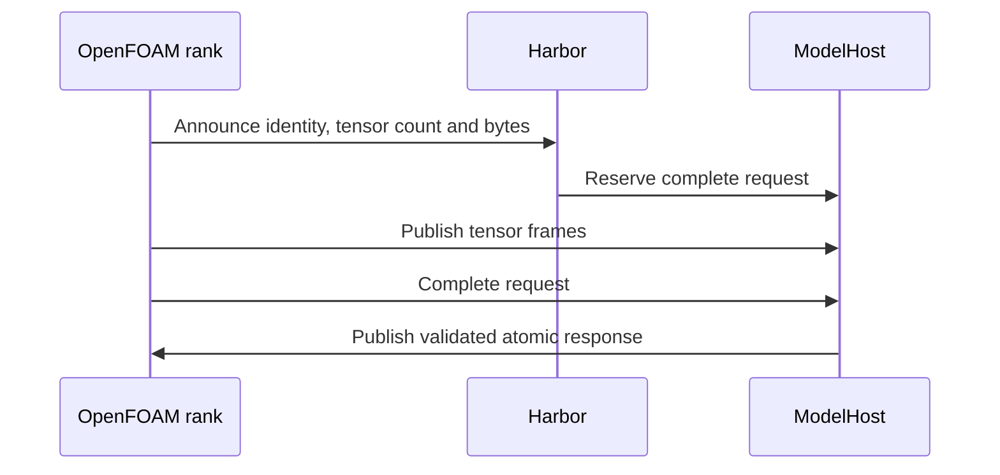

# Native transport
Fjord carries numeric tensors between OpenFOAM ranks and ModelHost. Rune defines the binary frame, while Harbor applies atomic exchange semantics over a selected channel.

## Exchange contract

| Identity field | Purpose |
| --- | --- |
| Exchange index | Orders repeated calls from one rank |
| Solver time index | Associates the request with solver progression |
| Physical time | Preserves the OpenFOAM time value |
| Rank | Identifies the rank-local field partition |
| Topology generation | Rejects responses produced for stale mesh storage |
| Tensor count and bytes | Supports admission before body allocation |

Before tensor bodies, the solver announces exchange identity, tensor count, and total payload bytes. ModelHost reserves the complete request, then accepts the bodies. Completion commits only when count, size, shape, and identity match.

Outputs use the same atomic boundary. Every tensor is validated, floating outputs must be finite, and publication credit remains held until the receiver accepts the complete result.

Rune carries the solver-owned topology generation in request announcements, tensors and completion markers. Harbor requires one generation throughout an atomic batch, and the OpenFOAM adapter rejects stale responses before writing any solver-owned destination.

## Channels

| Channel | Intended use |
| --- | --- |
| Unix socket | local control and node-local fallback |
| Shared memory | normal same-node bulk payload path |
| TCP | explicit portable cross-node path |
| UCX | optional high-performance native path |

Capability negotiation selects only a channel supported by both peers. An explicit request fails if unavailable; it does not silently change transport.

## Memory ownership

| Memory | Owner until |
| --- | --- |
| Receive credit | Complete request is rejected or consumed |
| Input frames | ModelHost accepts and validates the request |
| Execution workspace | Evaluation and output validation finish |
| Output publication | Solver accepts the complete response |
| Retained workspace | Capacity is needed by an admissible request or the host exits |

Receive buffers, active execution storage, retained workspace capacity, and output publication each have an explicit owner and bound. Retained storage is a cache and is released when it would block new work. Cancellation wakes admission waiters and returns credits.

Each solver rank has an independent exchange. A node-local ModelHost serves only ranks on its node, keeping shared memory and model state node-local.
