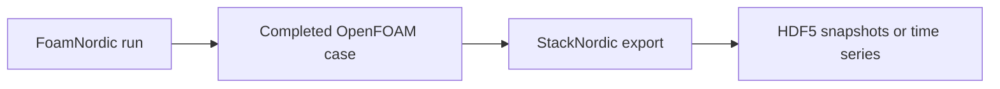

# From an OpenFOAM run to a dataset

FoamNordic owns solver execution and returns the generated case through `result.case`. StackNordic reads that case and exports stored fields. The hand-off uses files; it does not add Python to the solver loop or couple the two package APIs.



## Export a completed run

Start with a `run` returned by `fno.Longship(...).launch()` and wait for successful completion. The example uses the macOS OpenFOAM launcher; on HPC, use the same module command and shell selected for the original run.

```python
from pathlib import Path
import stacknordic as sno

result = run.stop(timeout=900, progress=True)
if not result.success:
    raise RuntimeError(f"OpenFOAM run failed; inspect {result.logs}")

stored = sno.OpenFOAM.case(case_dir=result.case, of_cmd="openfoam", shell="zsh")
dataset = stored.export(
    output_dir=Path("datasets/cavity"),
    fields={"U": ("Ux", "Uy", "Uz"), "p": "p"},
    times=None, mode="direct", dtype="float32", n_jobs=1, progress=True,
)
```

`times=None` exports every complete stored time. Direct export prefers reconstructed fields and can also decode supported decomposed layouts. Keep source cases intact. See [FoamNordic run control](../foamnordic/api/run-control.md) and [StackNordic export](../stacknordic/api/dataset.md#dataset-export) for selection and runtime options.

## Package and compile

Packaging requires a verified Cartesian dataset. Cell-indexed exports remain valid for stored-data analysis but are not eligible for this packaging path.

```python
snapshots = Path("datasets/cavity-snapshots")
sno.Dataset.package(
    dataset_dir=Path("datasets/cavity"), output_dir=snapshots, name="cavity",
    fields={"U": "fields/U", "p": "fields/p"}, n_jobs=1, progress=True,
)
sno.Dataset.compile(
    dataset_dir=snapshots, output_file=Path("datasets/cavity.h5"),
    pattern="cavity_id*.h5", progress=True,
)
```

Use logical field names such as `U` when packaging; `Ux`, `Uy` and `Uz` are its exported components. The manifest preserves that association. See [Stored-data layout](../stacknordic/architecture/data-layout.md) and [Storage API](../stacknordic/api/dataset.md#snapshot-packaging).

## Reduce or deploy

Choose [StackNordic filtering](../stacknordic/api/filtering.md) according to the physical quantity and available density. Align physical times, coordinates, units and component order before comparing independent simulations; matching array shapes alone is insufficient.

A trained model is a separate output. Declare its tensor contracts and export a [FoamNordic FNOM artefact](../foamnordic/api/model-artifact.md) before coupling it to a solver. Dataset names do not implicitly define model tensor bindings.
